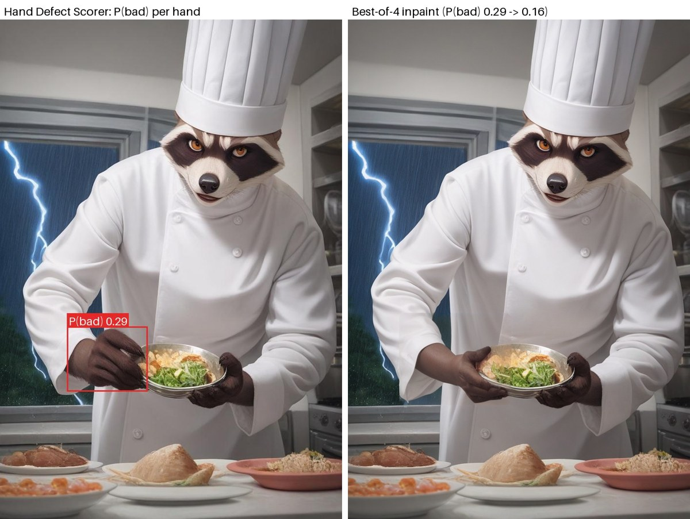
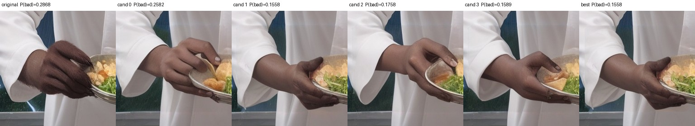
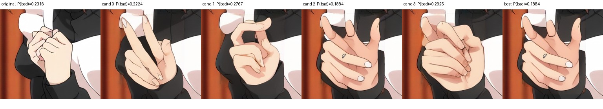
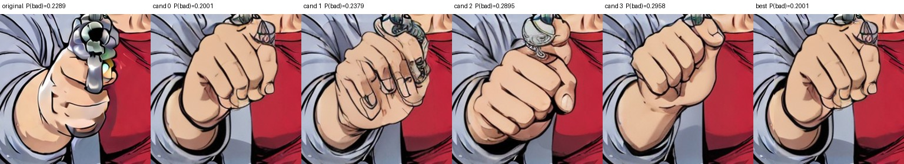

# ComfyUI Hand Fixer

Find malformed hands in generated images, mask them for inpainting, and keep the inpainting attempt whose hands look best.



*Left: the scorer flags one of the chef's hands (P(bad) 0.29, red box). Right: the best of 4 SD1.5 inpaints according to the
same scorer (P(bad) 0.16). Produced by the example workflow in headless ComfyUI on a Kaggle T4.*

> **Honest accuracy note.** On our independent human-labelled test round (75 hands from Civitai images, 8 broken),
> the HADM-L backend ranks broken hands with **AUC 0.76 [95% CI 0.51–0.96]**; pooled over two rounds (182 hands, 17 broken)
> it is **0.72 [0.54–0.87]**. That is a useful *triage* signal, not a reliable QC gate: at a 10% false-alarm rate it caught
> 28% of broken hands on that round. The light CLIP-L backend is clearly weaker (0.58 / 0.60). Details and the full study:
> [ai-hand-defect-detector](https://github.com/tablesizedogo/ai-hand-defect-detector).

## Nodes (category `image/hand fixer`)

| node | inputs | outputs |
|---|---|---|
| **Load Hand Defect Scorer** | `backend` (`hadm` / `clip_l14_student (weaker, light)`), `device`, `hand_detector` file, `allow_download` | `HAND_SCORER` |
| **Hand Defect Scorer** | `image`, `hand_scorer`, `threshold` (P(bad), default 0.2), `det_conf` (0.3), `mask_grow` (0.15) | `bad_hands_mask` (MASK), `preview` (IMAGE, red = bad, green = ok), `scores_json` (STRING), `n_bad` (INT) |
| **Hand Fix: Best-of-N Selector** | `original`, `candidates` (N inpainted images), `hand_scorer`, `candidates_per_image`, `include_original`, `composite_with_original`, `det_conf`, optional `mask` | `best` (IMAGE), `report_json` (STRING), `best_index` (INT, −1 = original kept) |

How a hand is scored:
1. Hands are found with the ADetailer `hand_yolov8s` detector.
2. HADM-L (a human-artifact detector) runs once on the whole image.
3. For each hand, `raw` = the highest HADM `hand`-artifact score among detections with ≥ 50% of their area inside a square
   of 1.3× the hand box's longer side (0 if none).
4. `P(bad) = sigmoid(4.108 · raw − 4.039)`, Platt-calibrated on 182 human-labelled hands. The base rate of broken hands in
   that corpus is about 10%, so `P(bad) = 0.2` already means "twice as suspicious as average"; raw 0.7 maps to 0.24.

Best-of-N scores every candidate on the **hand regions of the original image** (the hands that overlap the mask), so a
candidate cannot win by erasing the hand. With `include_original` on, the original is a candidate too and wins ties, so
a workflow never returns something the scorer rates worse than the input.

## Install

```bash
cd ComfyUI/custom_nodes
git clone https://github.com/tablesizedogo/ComfyUI-Hand-Fixer
cp -r ComfyUI-Hand-Fixer/custom_nodes/comfyui-hand-fixer .     # the node pack itself
pip install -r comfyui-hand-fixer/requirements.txt              # use ComfyUI's Python
python comfyui-hand-fixer/download_models.py                    # ~5.8 GB, see below
```

`download_models.py` puts third-party files into `ComfyUI/models/hand_fixer/` (override with `--models-dir` or the
`HAND_FIXER_MODELS` environment variable). Nothing below is redistributed by this repository:

| file | source | license |
|---|---|---|
| `hand_yolov8s.pt` (22.5 MB) | [Bingsu/adetailer](https://huggingface.co/Bingsu/adetailer) | Apache-2.0 (runs with ultralytics, AGPL-3.0) |
| `hadm/HADM/` | `git clone` of [wangkaihong/HADM](https://github.com/wangkaihong/HADM) at commit `d09f667` | **no license file**; research code |
| `hadm/HADM-L_0249999.pth` (5.7 GB, sha256 `3a495952…d407f3`) | the HADM authors' download link | **no license file**; research use |

`--no-hadm` fetches only the hand detector (enough for the CLIP-L backend). The loader node can also download missing files
itself if you switch `allow_download` on; it is off by default because the HADM weights are 5.7 GB and unlicensed.

### Running HADM without building detectron2 or xformers

HADM is a detectron2 / ViTDet EVA-02-L Cascade R-CNN written for torch 1.x with xformers. The clone is used **unmodified**
(one symlink is added: `detectron2/model_zoo/configs → configs`). Everything else is done at runtime in
`hand_fixer/hadm_backend.py`, so no patch file and no compilation are needed:

- xformers attention is replaced by `torch.nn.functional.scaled_dot_product_attention` (same math);
- inference does not need detectron2's C++ ops; torchvision provides ROIAlign / NMS;
- missing training-only imports are stubbed (wandb, mmcv `soft_nms`, fairscale `checkpoint_wrapper`, `pkg_resources`), and the old Pillow resampling aliases are restored;
- the pickled checkpoint is loaded with `weights_only=False` **only inside** the loader (its size is checked first), and the setting is restored afterwards.

The HADM backend imports HADM's own copy of `detectron2`. It refuses to load if a different `detectron2` is already
imported in the same ComfyUI process, for example by another node pack.

### VRAM and speed (T4, 16 GB)

HADM-L takes about 1.6 s per 1024 px image on a T4 and ran next to an SD1.5 model on one 16 GB T4 without problems (peak VRAM was not measured). The example workflow (one HADM
pass, four 25-step inpaint candidates at about 1024×700, and five HADM passes in Best-of-N) took 65–130 s per image.
The CLIP-L backend scored an image in under 1 s once loaded (its first call includes a 1.7 GB OpenCLIP download).

## Example workflow

[`workflows/hand_fix_sd15_inpaint_api.json`](workflows/hand_fix_sd15_inpaint_api.json) uses API format (you can load
it in the ComfyUI UI, or POST it to `/prompt`), with stock nodes only:

`LoadImage → Hand Defect Scorer → GrowMask → VAEEncodeForInpaint → RepeatLatentBatch(4) → KSampler → VAEDecode → Best-of-N → SaveImage`

The checkpoint is [DreamShaper 8 inpainting](https://huggingface.co/Lykon/DreamShaper)
(`DreamShaper_8_INPAINTING.inpainting.safetensors`; see its model card for the license, which is CreativeML OpenRAIL-M on Civitai). Put it in `models/checkpoints/`, or pick
any SD1.5 inpainting model. The prompts are generic ("detailed hand, natural hand anatomy, five fingers" / "nsfw, nude,
deformed hand, extra fingers, …"). **Replace the positive prompt with the image's own prompt** to keep held objects;
see the examples below. The Impact Pack's detailer nodes work too: feed `bad_hands_mask` into them, then use Best-of-N
on their outputs.

## End-to-end test (what was actually run)

| Item | Result |
|---|---|
| setup | headless ComfyUI (commit `faa7e49`), torch 2.11 + CUDA 12.8, a private Kaggle T4 kernel ([`scripts/kaggle_e2e/e2e.py`](scripts/kaggle_e2e/e2e.py)) |
| images | 5 SFW Civitai images (1024 px long side), each containing a hand that a human had labelled BROKEN |
| status | 5 of 5 HADM workflows and 5 of 5 CLIP-L scorer-only workflows ran successfully; total session 11.3 min including installs and 7.8 GB of downloads |
| scorer | 3 of 5 labelled-broken hands were flagged at the 0.2 threshold; the other two scored 0.10 and 0.18. For 4 of the 5 hands the HADM raw score matched our earlier offline HADM run to within 0.007 (0.76 / 0.69 / 0.69 / 0.62). On the fifth, the single detector gave a different box from the one used offline |
| Best-of-N | for the 3 flagged images it picked a candidate with lower P(bad): 0.29 → 0.16, 0.23 → 0.19, 0.23 → 0.20. For the 2 unflagged images it kept the original |
| CLIP-L backend | flagged none of the 5 (P(bad) 0.06–0.11), consistent with it being the weaker backend |

Raw outputs are in [`docs/e2e_report.json`](docs/e2e_report.json). Visual check of the three repaired images:


*Good case: all four candidates are plausible hands holding the bowl, and the chosen one has the lowest P(bad).*


*Ambiguous: the "best" candidate (0.19) changes the clasped hands into a different gesture. To a human it is not clearly better.*


*Failure: with the generic prompt the inpaint removes the revolver, and the scorer's small improvement (0.23 → 0.20) does not reflect that.*

**What this does and does not show.** The nodes work end-to-end inside real ComfyUI: masks, batching, the /8 latent crop,
compositing and selection. Whether the selected hands are *actually* better was judged only by eye on these 3 images. There
is no before/after study on fresh generations yet, so treat Best-of-N as "lets HADM pick among attempts", not as a proven
fix rate.

## Limitations

- Scores unusual but correct hands (gloves, robots, skeletons, heavy stylization, blur) as suspicious, and misses subtle
  finger-count errors on grips and fists.
- The hand detector misses some hands (in the chef image, only one of two hands was found). A missed hand is never scored or fixed.
- The workflow always runs the sampler, even when `n_bad = 0` (the mask is empty, so the image is unchanged and the
  original is returned). Core ComfyUI has no conditional skip.
- HADM was trained on its authors' data; our calibration has only 17 broken hands behind it, so read P(bad) as approximate.

## Tests

```bash
pip install -r requirements-dev.txt
python -m pytest tests -q
```

Unit tests mock the hand detector and HADM, and cover geometry, masks, compositing, the /8 crop, Best-of-N, ties and batching.
Two optional tests build the real backends on CPU when these variables point to local files:
`HAND_FIXER_TEST_HADM_REPO` (a HADM clone; uses random weights, so no 5.7 GB download) and `HAND_FIXER_TEST_YOLO` + `HAND_FIXER_TEST_IMAGE`.

## Credits and licenses

- This node pack: MIT, © 2026 tablesizedogo.
- **HADM**: K. Wang, L. Zhang, J. Zhang, *Detecting Human Artifacts from Text-to-Image Models*, arXiv:2411.13842,
  [github.com/wangkaihong/HADM](https://github.com/wangkaihong/HADM). The repository has no license file, so its code and
  weights are not included here and are fetched from the authors' sources. Check their terms before commercial use.
- **ADetailer hand detector**: [Bingsu/adetailer](https://huggingface.co/Bingsu/adetailer), Apache-2.0. Runs with
  [ultralytics](https://github.com/ultralytics/ultralytics), AGPL-3.0.
- **CLIP-L student**: our own logistic-regression head (`models/hand_ok_clip_l14_logreg.onnx`) on OpenCLIP ViT-L/14
  `laion2b_s32b_b82k` (MIT) embeddings.
- **DreamShaper 8 inpainting** (example workflow only): Lykon; license per its model card (CreativeML OpenRAIL-M on Civitai).
- Example images: Civitai generations used only as test inputs; they belong to their authors.
